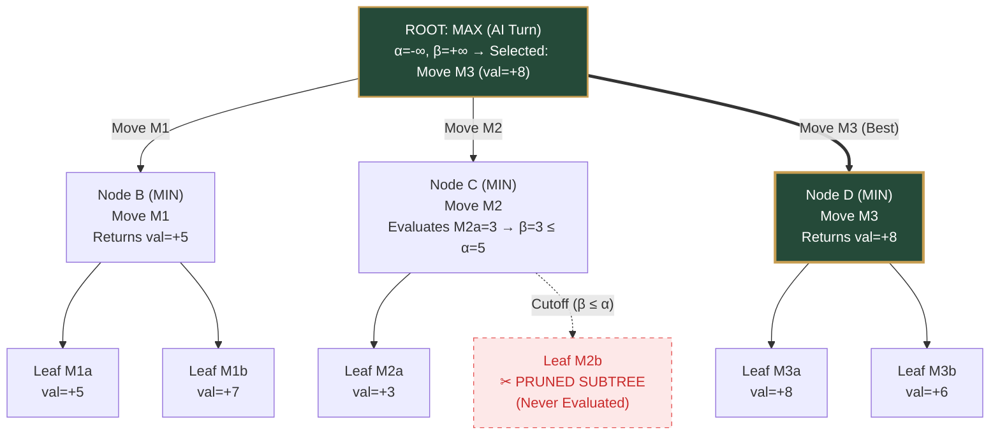
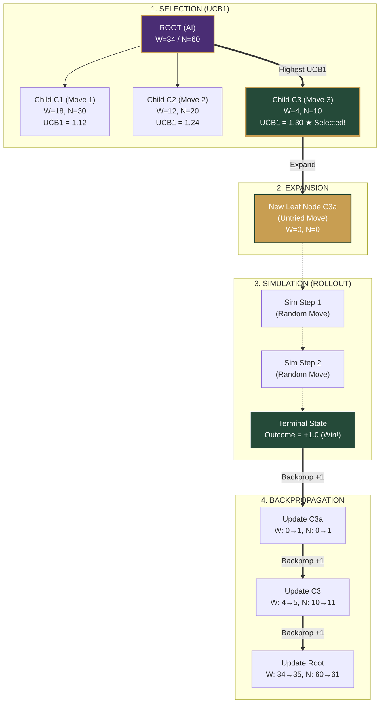

# Checkers AI — Dual-Engine Strategy Board Game

A complete, feature-rich implementation of American / English Checkers (Draughts) engineered with an object-oriented architecture and dual artificial intelligence search engines: **Minimax with Alpha-Beta Pruning** and **Monte Carlo Tree Search (MCTS)**.

**Authors & Developers**: Developed by **Md. Safiul Islam** and **Md. Mesbaul Islam** as a comprehensive artificial intelligence and game-engineering project.

The project features two distinct, fully functional implementations:
1. **Python Desktop Application**: Built with Python 3 and Pygame, featuring smooth drag-and-drop piece manipulation, visual move markers, AI benchmarking CLI commands, and automated move scheduling.
2. **Modern Web Application**: Built with clean, zero-dependency HTML5, CSS3, and modern ES6+ JavaScript, featuring a responsive luxury board interface, real-time algorithm HUD, dynamic in-game algorithm switching, and configurable match countdown timers with tournament piece-advantage adjudication.

---

## Table of Contents

- [Authors & Developers](#authors--developers)
- [Core Features](#core-features)
- [Official Game Rules & Mechanics](#official-game-rules--mechanics)
  - [Board Geometry & Coordinates](#board-geometry--coordinates)
  - [Initial Setup & Colors](#initial-setup--colors)
  - [Regular Piece Movement](#regular-piece-movement)
  - [Mandatory Capture Rule](#mandatory-capture-rule)
  - [Jump Mechanics & Multi-Jumps (Chaining)](#jump-mechanics--multi-jumps-chaining)
  - [King Promotion & Crowning](#king-promotion--crowning)
  - [Win Conditions](#win-conditions)
  - [Draw Conditions](#draw-conditions)
- [Game Modes](#game-modes)
- [Match Time Limit & Adjudication](#match-time-limit--adjudication)
- [Artificial Intelligence & Algorithmic Logic](#artificial-intelligence--algorithmic-logic)
  - [Algorithm 1: Minimax with Alpha-Beta Pruning](#algorithm-1-minimax-with-alpha-beta-pruning)
  - [Minimax Decision & Pruning Simulation Tree](#minimax-decision--pruning-simulation-tree)
  - [Algorithm 2: Monte Carlo Tree Search (MCTS)](#algorithm-2-monte-carlo-tree-search-mcts)
  - [MCTS Search & Simulation Tree (4-Stage Cycle)](#mcts-search--simulation-tree-4-stage-cycle)
  - [Board Evaluation Heuristics](#board-evaluation-heuristics)
  - [Dynamic Live Algorithm Switching](#dynamic-live-algorithm-switching)
- [Project Architecture & Codebase](#project-architecture--codebase)
  - [Python Application Structure](#python-application-structure)
  - [Web Application Structure](#web-application-structure)
  - [Automated Test Suite](#automated-test-suite)
- [Installation & Setup](#installation--setup)
  - [Prerequisites](#prerequisites)
  - [Python Environment Setup](#python-environment-setup)
- [Running the Application](#running-the-application)
  - [Running the Python Pygame Version](#running-the-python-pygame-version)
  - [Running the Web Version](#running-the-web-version)
  - [Running Unit Tests](#running-unit-tests)
- [Engineering & Design Principles](#engineering--design-principles)

---

## Authors & Developers

This project was conceived, designed, and developed by:
- **Md. Safiul Islam**
- **Md. Mesbaul Islam**

---

## Core Features

- **Tournament Rule Compliance**: Strict adherence to American / English Draughts rules, including mandatory jumping, multi-jump capture continuation, king crowning, and stalemate detection.
- **Dual AI Search Engines**:
  - **Minimax with Alpha-Beta Pruning**: Deep recursive search tree optimization skipping subtrees that cannot affect the minimax value.
  - **Monte Carlo Tree Search (MCTS)**: Statistical tree exploration using the Upper Confidence Bound for Trees (UCB1) formula and heuristic rollouts.
- **AI Decision Simulation Trees**: Documented simulation and game-tree traversal mechanisms illustrating how candidate moves are evaluated, pruned, and selected.
- **Live Algorithm Display & Switching**:
  - Pre-match selection on the Game Mode screen.
  - Mid-game dynamic algorithm swapping via the Active Algorithm HUD without restarting the match.
  - Clear visual HUD badges indicating which engine is calculating moves for White and Black.
- **Configurable Match Time Limit (Optional)**:
  - Select between **No Limit (Untimed)**, **1 Min (Blitz)**, **2 Min (Speed)**, **3 Min (Rapid)**, or **5 Min (Standard)**.
  - Real-time countdown clock in both the header and the game status sidebar.
  - Color-coded warning states ($ \le 30\text{s} $ warning, $ \le 10\text{s} $ pulsating critical alert).
  - Rule-based adjudication on expiration: primary tiebreaker by total piece count, secondary tiebreaker by king count, tertiary draw.
- **Three Versatile Game Modes**:
  - **Human vs Human (`pvp`)**: Local two-player hotseat match on the same device.
  - **Human vs AI (`cpu`)**: Solo challenge controlling the White pieces against the computer.
  - **AI vs AI (`ai`)**: High-speed spectator benchmarking duel between two autonomous search engines.
- **Dual Platform Interfaces**:
  - **Pygame Desktop**: Drag-and-drop piece physics, highlighted legal move targets, and command-line algorithm configuration.
  - **Web Browser**: Elegant luxury aesthetic (forest green, warm ivory, and gold accents), responsive CSS Grid/Flexbox layout for mobile, tablet, and desktop viewports, and zero build tool dependencies.
- **Comprehensive Testing**: Pytest unit test suite covering piece movement, board boundaries, king behavior, capture forcing, and AI minimax/MCTS decisions.

---

## Official Game Rules & Mechanics

The game strictly enforces standard American / English Checkers rules:

```
      BLACK (AI / Player 2) - Starts on Rows 0, 1, 2
         0   1   2   3   4   5   6   7
       +---+---+---+---+---+---+---+---+
   0   |   | 0 |   | 1 |   | 2 |   | 3 |
       +---+---+---+---+---+---+---+---+
   1   | 4 |   | 5 |   | 6 |   | 7 |   |
       +---+---+---+---+---+---+---+---+
   2   |   | 8 |   | 9 |   |10 |   |11 |
       +---+---+---+---+---+---+---+---+
   3   |12 |   |13 |   |14 |   |15 |   |
       +---+---+---+---+---+---+---+---+
   4   |   |16 |   |17 |   |18 |   |19 |
       +---+---+---+---+---+---+---+---+
   5   |20 |   |21 |   |22 |   |23 |   |
       +---+---+---+---+---+---+---+---+
   6   |   |24 |   |25 |   |26 |   |27 |
       +---+---+---+---+---+---+---+---+
   7   |28 |   |29 |   |30 |   |31 |   |
       +---+---+---+---+---+---+---+---+
      WHITE (Player 1) - Starts on Rows 5, 6, 7
```

### Board Geometry & Coordinates

- The board consists of an $8 \times 8$ grid of 64 squares. Only the 32 dark squares are playable.
- Playable squares are indexed from `0` to `31` from top-left to bottom-right (4 playable squares per row).
- Row and column conversion formulas:
  - $\text{row} = \lfloor \frac{\text{position}}{4} \rfloor$
  - $\text{column} = (\text{position} \pmod 4) \times 2 + (\text{row} \pmod 2)$
  - $\text{position} = \text{row} \times 4 + \lfloor \frac{\text{column} - (\text{row} \pmod 2)}{2} \rfloor$

### Initial Setup & Colors

- **White Pieces (`W`)**: 12 pieces positioned on squares `20` through `31` (rows 5, 6, 7). White always moves first.
- **Black Pieces (`B`)**: 12 pieces positioned on squares `0` through `11` (rows 0, 1, 2).

### Regular Piece Movement

- Uncrowned regular pieces ("men") move diagonally forward one step into an unoccupied dark square:
  - **White men** move upward (decreasing row index: `[-1, -1]` and `[-1, +1]`).
  - **Black men** move downward (increasing row index: `[+1, -1]` and `[+1, +1]`).

### Mandatory Capture Rule

- If a player has one or more legal capture jumps available anywhere on the board on their turn, **they must make a capture**.
- Simple diagonal steps are considered illegal and discarded whenever any capture move exists for that player.

### Jump Mechanics & Multi-Jumps (Chaining)

- A jump capture occurs when an adjacent diagonal square contains an opponent piece, and the immediate square directly behind it along the same diagonal is vacant.
- The capturing piece leaps over the opponent piece onto the vacant destination, and the captured piece is removed from the board.
- **Chained Jumps (Multi-Jumps)**: If the same piece lands on a square where another jump capture is immediately possible, the player's turn does not end. The player **must continue jumping with the same piece** until no further captures can be made from that position.

### King Promotion & Crowning

- When a regular piece reaches the farthest rank on the opponent's side of the board:
  - **White piece** reaches row `0` (positions `0, 1, 2, 3`).
  - **Black piece** reaches row `7` (positions `28, 29, 30, 31`).
- The piece is immediately crowned as a **King** (marked with a crown symbol `♛` in the UI).
- **King Capabilities**: Kings can move and jump diagonally in all four directions (both forward and backward).
- In accordance with standard American rules, if a piece reaches the king row as the result of a jump, it is crowned and its turn terminates immediately; it cannot continue jumping as a king in that same turn.

### Win Conditions

A player wins the match if any of the following occur:
1. **Total Elimination**: The opponent has zero remaining pieces on the board.
2. **Blockade / Stalemate**: The opponent has pieces remaining, but has no legal moves available on their turn.
3. **Time Limit Expiration (Material Advantage)**: When a match countdown timer runs out, the player with the greater total piece count wins. If total piece counts are tied, the player with more kings wins.

### Draw Conditions

A draw is declared in the web version under any of the following conditions:
1. **Time Expiration Material Equality**: The timer expires and both players have the exact same total piece count and king count.
2. **40-Move Quiet Rule**: 40 consecutive moves by each side occur without a single capture or king crowning.
3. **Threefold Repetition**: The exact same board position (same piece coordinates, king statuses, and active turn) recurs three times during the match.

---

## Game Modes

| Mode | Identifier | Description | Controls |
| :--- | :--- | :--- | :--- |
| **Human vs Human** | `human-human` / `pvp` | Local two-player head-to-head match on the same computer screen with alternating turns. | Players take turns manually dragging (Python) or clicking (Web) pieces. |
| **Human vs AI** | `human-ai` / `cpu` | Solo match where the human controls the White pieces against an autonomous AI search engine commanding the Black pieces. | Player makes a move; opponent engine calculates and executes response automatically. |
| **AI vs AI** | `ai-ai` / `ai` | High-speed spectator demonstration where two autonomous engines compete against each other. | Fully automated playback for benchmarking and algorithmic comparison. |

---

## Match Time Limit & Adjudication

An optional tournament match countdown timer can be set prior to starting a match on the Game Mode selection screen:

| Option | Duration | Target Style |
| :--- | :--- | :--- |
| **No Limit** | Unlimited | Relaxed, untimed match with no expiration clock. |
| **1 Min** | 60 seconds | Lightning Blitz — Fast tactical play under high time pressure. |
| **2 Min** | 120 seconds | Speed Match — Balanced rapid tactical engagement. |
| **3 Min** | 180 seconds | Rapid Action — Standard rapid tournament format. |
| **5 Min** | 300 seconds | Classical Play — Ample time for deep positional strategy. |

### Visual HUD Indicators
- **Header Badge**: Prominently displays the live countdown clock in the top bar.
- **Match Panel Bar**: Synchronized live digital readout with a status indicator in the game sidebar.
- **Warning State ($ \le 30\text{s} $)**: Timer shifts to warm amber.
- **Critical Alert State ($ \le 10\text{s} $)**: Timer shifts to vivid crimson with a continuous CSS pulse animation.

### Time-Expired Adjudication Hierarchy
When the countdown clock reaches `00:00`, the game stops immediately and applies standard tournament adjudication rules:
1. **Primary Tiebreaker — Total Pieces**:
   $$\text{Winner} = \begin{cases} \text{White}, & \text{if } N_{\text{White}} > N_{\text{Black}} \\ \text{Black}, & \text{if } N_{\text{Black}} > N_{\text{White}} \end{cases}$$
2. **Secondary Tiebreaker — King Count (if total pieces are equal)**:
   $$\text{Winner} = \begin{cases} \text{White}, & \text{if } K_{\text{White}} > K_{\text{Black}} \\ \text{Black}, & \text{if } K_{\text{Black}} > K_{\text{White}} \end{cases}$$
3. **Tertiary Resolution — Match Draw**:
   $$\text{Result} = \text{Draw}, \quad \text{if } N_{\text{White}} = N_{\text{Black}} \text{ and } K_{\text{White}} = K_{\text{Black}}$$

---

## Artificial Intelligence & Algorithmic Logic

### Algorithm 1: Minimax with Alpha-Beta Pruning

The Minimax algorithm models checkers as a zero-sum two-player game. The maximizing player (the AI) selects moves to maximize its board evaluation, while assuming the minimizing opponent will choose moves to minimize that evaluation.

$$\begin{aligned}
\text{Minimax}(s, d, \alpha, \beta, \text{True}) &= \max_{m \in \text{Moves}(s)} \text{Minimax}(\text{Result}(s, m), d-1, \alpha, \beta, \text{False}) \\
\text{Minimax}(s, d, \alpha, \beta, \text{False}) &= \min_{m \in \text{Moves}(s)} \text{Minimax}(\text{Result}(s, m), d-1, \alpha, \beta, \text{True})
\end{aligned}$$

#### Alpha-Beta Pruning Optimization
To eliminate redundant branch exploration, Alpha-Beta pruning maintains two bounds during recursive depth-first search:
- **$\alpha$ (Alpha)**: The minimum score that the maximizing player is assured of.
- **$\beta$ (Beta)**: The maximum score that the minimizing player is assured of.

Whenever $\beta \le \alpha$, the remaining child nodes of the current branch are pruned (skipped), as the opponent would never permit this state to be reached. This reduces the search complexity from $O(b^d)$ down toward $O(b^{d/2})$ in the best case, allowing deeper lookahead within identical compute time.

---

### Minimax Decision & Pruning Simulation Tree

The simulation tree below illustrates how the Minimax agent evaluates candidate branches, propagates $\alpha$ and $\beta$ values, and prunes subtrees to decide its optimal move:

```
                          [ ROOT: MAXIMIZER (AI) ]
                             (Target: MAX score)
                            Initial: α = -∞, β = +∞
                             /         |         \
                            /          |          \
                  Move M1  /    Move M2|           \ Move M3 [CHOSEN!]
                          /            |            \
                         v             v             v
                   [Node B: MIN]  [Node C: MIN]  [Node D: MIN]
                      (β ≤ 5)        (β ≤ 3)        (β ≤ 8)
                      /     \        /     \        /     \
                     /       \      /       \      /       \
                    v         v    v         v    v         v
                  [M1a]     [M1b] [M2a]    [M2b] [M3a]    [M3b]
                  val=5     val=7 val=3    [CUT] val=8    val=6
                                             ✂
                                          PRUNED!
                                      (β=3 ≤ α=5)
```



#### Step-by-Step Decision Walkthrough:
1. **Branch $M_1$ Evaluation**:
   - Leaf $M_{1a}$ evaluates to $+5$, Leaf $M_{1b}$ evaluates to $+7$.
   - Since Node $B$ is a **Minimizer**, it chooses $\min(5, 7) = +5$.
   - The Root (Maximizer) receives $+5$ and updates its lower bound: $\alpha = \max(-\infty, 5) = +5$.
2. **Branch $M_2$ Evaluation & Alpha-Beta Cutoff**:
   - Node $C$ (Minimizer) evaluates its first leaf $M_{2a}$, which yields $+3$.
   - Node $C$ updates its upper bound: $\beta = \min(+\infty, 3) = +3$.
   - The pruning condition triggers: $\beta \le \alpha$ ($3 \le 5$).
   - **Reasoning**: The Root is already guaranteed at least $+5$ via $M_1$. Node $C$ will never allow a score greater than $+3$. Thus, the Root will never choose $M_2$, and all remaining siblings ($M_{2b}, \dots$) are immediately **pruned** without wasting computation.
3. **Branch $M_3$ Evaluation & Move Selection**:
   - Leaf $M_{3a}$ evaluates to $+8$, Leaf $M_{3b}$ evaluates to $+6$.
   - Node $D$ (Minimizer) chooses $\min(8, 6) = +8$ (assuming worst-case for AI under that branch).
   - The Root updates $\alpha = \max(5, 8) = +8$.
4. **Final Decision**: The AI selects **Move $M_3$** as it guarantees the maximum achievable utility ($+8$).

---

### Algorithm 2: Monte Carlo Tree Search (MCTS)

MCTS builds an asymmetric game tree guided by random playouts (simulations), making it effective without relying exclusively on handcrafted board evaluation formulas.

#### The 4 Iterative Phases of MCTS
1. **Selection**: Traverse the tree from root to leaf using UCB1.
2. **Expansion**: Expand an unexplored legal move node.
3. **Simulation (Rollout)**: Execute rapid semi-random playouts until reaching a terminal or horizon state.
4. **Backpropagation**: Propagate the outcome back to the root, updating node visits ($N$) and win scores ($W$).

$$\text{UCB1}(i) = \frac{W_i}{N_i} + C \cdot \sqrt{\frac{\ln N_{\text{parent}}}{N_i}}$$
where:
- $W_i$: Cumulative wins of child node $i$.
- $N_i$: Visit count of child node $i$.
- $N_{\text{parent}}$: Total visits of the parent node.
- $C = \sqrt{2} \approx 1.414$: Exploration constant balancing exploitation ($W_i / N_i$) vs exploration.

---

### MCTS Search & Simulation Tree (4-Stage Cycle)

The diagram below illustrates how MCTS iteratively explores game states and selects the most robust action:

```
Iteration Cycle: Root has N = 60 visits
-------------------------------------------------------------------------
1. SELECTION: 
   Compare Child UCB1 scores:
   - Child C1: W=18, N=30  --> WinRate = 0.60, UCB1 = 0.60 + 1.414*√(ln 60 / 30) = 1.12
   - Child C2: W=12, N=20  --> WinRate = 0.60, UCB1 = 0.60 + 1.414*√(ln 60 / 20) = 1.24
   - Child C3: W=4,  N=10  --> WinRate = 0.40, UCB1 = 0.40 + 1.414*√(ln 60 / 10) = 1.30  <-- HIGHEST UCB1!
   Selection descends down Branch C3 due to high exploration potential!

2. EXPANSION:
   Add new unvisited legal state C3a to the tree.

3. SIMULATION (ROLLOUT):
   Execute rapid playout moves: C3a -> S1 -> S2 -> ... -> Terminal Win (+1.0).

4. BACKPROPAGATION:
   Propagate outcome (+1.0) upward:
   C3a (W: 1/1)  -->  C3 (W: 5/11)  -->  Root (W: 35/61)
```



#### Final Move Selection Policy:
When the allotted simulation budget (e.g. 500 iterations) expires, MCTS does **not** pick the node with the highest single rollout score; instead, it selects the child with the **highest visit count ($N$)**:
$$\text{Best Move} = \arg\max_{c \in \text{Children}(\text{Root})} N_c$$
This ensures the selected move is robust, battle-tested, and statistically resilient against opponent counter-strategies.

---

### Board Evaluation Heuristics

The heuristic evaluation function $f(s)$ estimates the strength of non-terminal board states:

| Factor | Weight / Calculation | Strategic Purpose |
| :--- | :--- | :--- |
| **Regular Piece (Man)** | $+100$ points | Base material advantage. |
| **King Piece** | $+175$ points | Rewards kings for their omnidirectional mobility and double capture capability. |
| **Pawn Advancement** | White: $(7 - \text{row}) \times 8$<br>Black: $\text{row} \times 8$ | Encourages advancing men toward the opposite edge for king promotion. |
| **King Centralization** | $(7 - \text{dist}_{\text{center}}) \times 3$ | Incentivizes kings to control the central board squares (`rows 3-4, cols 2-5`). |
| **Edge Protection** | $+4$ points on columns `0` and `7` | Encourages occupying side squares where pieces cannot be flanked or jumped from outside. |
| **Mobility Differential** | $(\text{Moves}_{\text{Self}} - \text{Moves}_{\text{Opp}}) \times 3$ | Rewards limiting opponent choices and avoiding stalemates. |
| **Terminal State** | Win: $+10000 + d \times 100$<br>Loss: $-10000 - d \times 100$ | Prioritizes rapid wins and delayed losses via depth bonuses. |

---

### Dynamic Live Algorithm Switching

Both players' engines can be configured and updated dynamically:
- **Pre-Game Configuration**: Select between Minimax and MCTS on the Game Setup screen for Human vs AI or pick preset AI matchups (`Minimax vs MCTS`, `MCTS vs Minimax`, `Minimax vs Minimax`, `MCTS vs MCTS`).
- **Live Mid-Game HUD Toggles**: During active play, the user can toggle the AI engine from the sidebar panel at any time. Changes take effect on the very next computer turn without interrupting the game state.
- **Active Engine Indicator**: The sidebar displays a real-time badge and status line reflecting whether Minimax (Alpha-Beta) or MCTS (Monte Carlo) is currently searching the board.

---

## Project Architecture & Codebase

The project maintains clean separation of concerns across modules:

### Python Application Structure

```
Checkers/
├── checkers.py         # Application entry point, CLI arguments, Pygame display & main loop
├── game_control.py     # Turn management, human click/drag handling, chained jumps & game state
├── board.py            # Board representation, piece tracking, move execution & king crowning
├── piece.py            # Piece entity, step directions, and diagonal jump target calculation
├── ai.py               # AI engine: Minimax with Alpha-Beta & MCTS with UCB1
├── board_gui.py        # Pygame surface rendering, board drawing, piece sprites & move markers
├── held_piece.py       # Visual representation and tracking of a piece during mouse dragging
├── utils.py            # Mathematical translation between board indices, row/col, and pixels
└── requirements.txt    # Python library dependencies (pygame, pytest)
```

### Web Application Structure

```
Checkers/web/
├── index.html          # Semantic HTML5 app shell: Welcome Screen, Mode Setup, & Game Interface
├── style.css           # Luxury design system: typography, responsive grids, piece styling, & timer animations
└── script.js           # Client-side ES6 engine: game loop, board state, timer logic, Minimax, & MCTS
```

### Automated Test Suite

```
Checkers/tests/
├── test_ai.py             # Unit tests for Minimax maximization, minimization, MCTS, and AI move getters
├── test_board.py          # Unit tests for piece lookup, coordinates, captures, and winner verification
├── test_piece.py          # Unit tests for quiet steps, bounds checking, forced jumps, and king logic
└── test_time_options.js   # Automated Node.js integration tests for time option selection and HUD reactivity
```

---

## Installation & Setup

### Prerequisites

- **Python**: Version 3.10 or higher.
- **Pygame**: Version 2.6 or higher.
- **Pytest**: Version 8.0 or higher (for running automated tests).
- **Web Browser**: Any modern browser (Chrome, Edge, Firefox, Safari) with JavaScript enabled.

### Python Environment Setup

#### Windows (PowerShell)

```powershell
# Navigate to the project root directory
cd Checkers

# Create virtual environment
python -m venv .venv

# Activate virtual environment
.\.venv\Scripts\Activate.ps1

# Install required dependencies
pip install -r requirements.txt
```

> **Note**: If script execution is restricted by PowerShell policies, run:
> ```powershell
> Set-ExecutionPolicy -ExecutionPolicy RemoteSigned -Scope CurrentUser
> ```
> Alternatively, execute scripts directly via `.\.venv\Scripts\python.exe`.

#### macOS / Linux

```bash
# Navigate to the project root directory
cd Checkers

# Create virtual environment
python3 -m venv .venv

# Activate virtual environment
source .venv/bin/activate

# Install required dependencies
pip install -r requirements.txt
```

---

## Running the Application

### Running the Python Pygame Version

Launch the Python version with your chosen game mode from the project root:

```bash
# 1. Human vs Human (2 Players on one machine)
python checkers.py pvp

# 2. Human vs AI (Play as White against Minimax AI)
python checkers.py cpu

# 3. Human vs AI (Play as White against MCTS AI)
python checkers.py cpu mcts

# 4. AI vs AI (Spectator match: Minimax White vs MCTS Black)
python checkers.py ai

# 5. AI vs AI (Custom matchups: [white_engine] [black_engine])
python checkers.py ai mcts minimax
python checkers.py ai minimax minimax
python checkers.py ai mcts mcts
```

### Running the Web Version

The web version is located in the [`web/`](web/) directory and runs natively in any browser with zero build steps or server dependencies.

#### Method 1: Local HTTP Server (Recommended)

From the project root directory, launch Python's built-in HTTP server:

```bash
python -m http.server 8000
```

Open your browser and navigate to:
```text
http://127.0.0.1:8000/web/index.html
```

#### Method 2: Direct File Loading

Open `web/index.html` directly in your web browser (double-click the file or use **File > Open File**).

---

### Running Unit Tests

Run the complete test suite from the project root directory:

```bash
# Run all Python unit tests with verbose output
python -m pytest -v

# Run the Node.js web time options integration test
node tests/test_time_options.js
```

---

## Engineering & Design Principles

1. **Single Responsibility Principle (SRP)**: Each class manages a dedicated aspect of the game. `Piece` calculates raw movement geometry; `Board` maintains grid occupancy; `GameControl` coordinates the turn loop; `AI` computes heuristics.
2. **Zero-Dependency Web Client**: The web application uses vanilla modern ES6+ JavaScript, CSS Grid, and Flexbox with no heavy external frameworks or build pipelines, ensuring instant load times and long-term maintainability.
3. **Defensive Rule Enforcement**: Mandatory captures are strictly prioritized by filtering non-jump moves whenever any jump exists on the board.
4. **Pure Functional State Simulation**: AI search methods operate on immutable or deep-copied board states, guaranteeing that exploratory tree searches never mutate the live board state.
5. **Responsive & Resilient UX**: The CSS layout gracefully responds to desktop, tablet, and mobile displays, featuring fallback event listeners and robust interactive controls.
